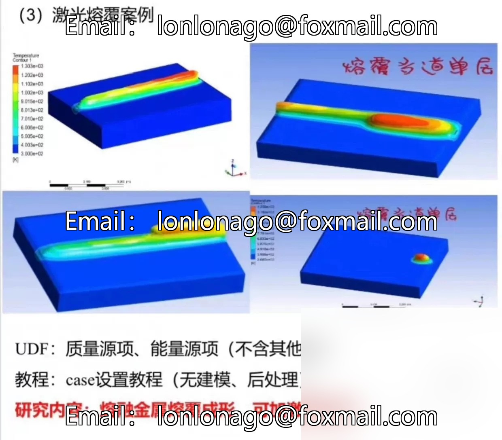
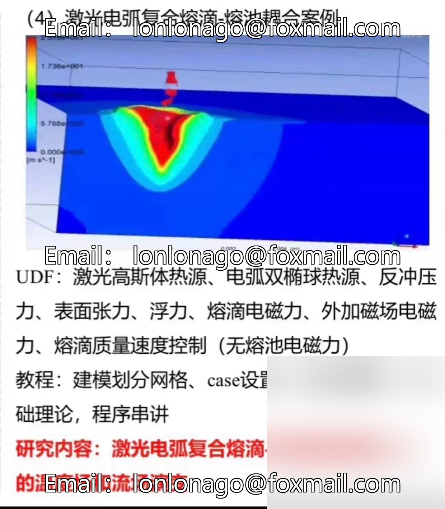
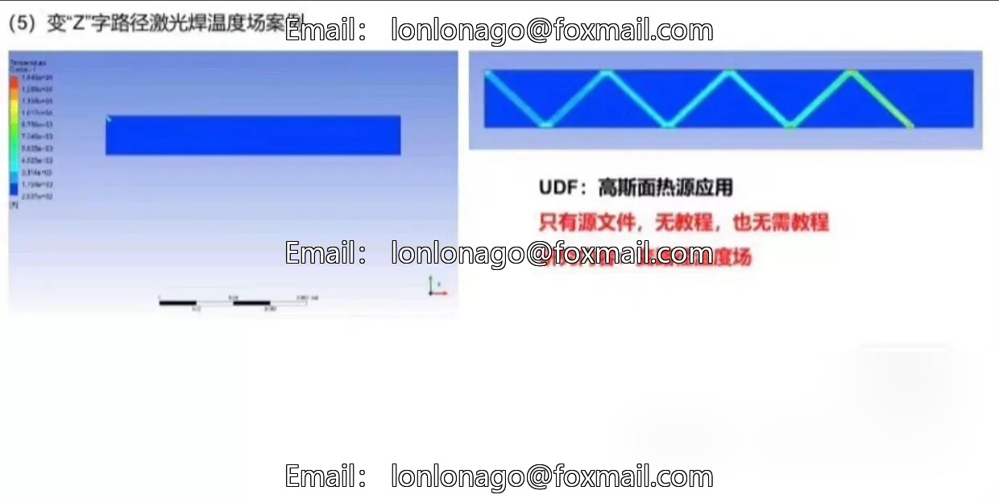
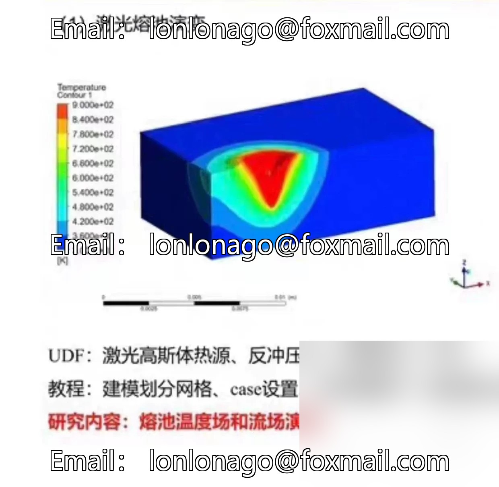
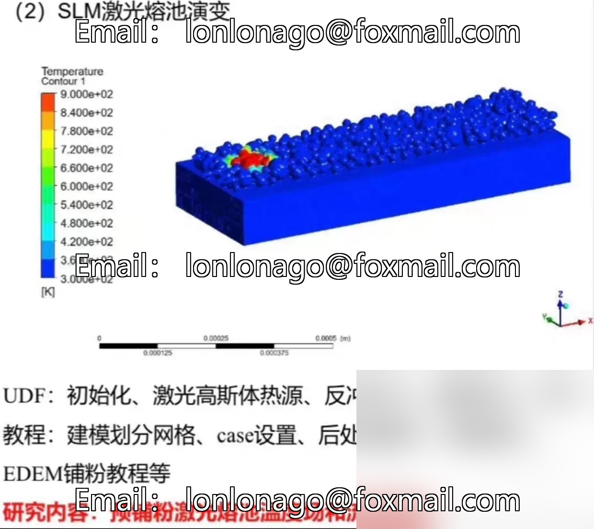

# Ansys Fluent laser welding additive numerical simulation

## Body

Ansys Fluent laser welding additive numerical simulation case, 5 beginner cases
All are
Laser weld pool evolution (video tutorial)
SLM laser weld pool evolution (video tutorial)
Laser cladding single layer, two layers, and two-layer single layer (program explanation)
Laser electric arc composite droplet weld pool interaction (video tutorial)
Change "Z"-shaped path laser weld temperature field model (case file) for arc welding, specific details as shown in the figure below.
All above content is packaged together for sale
Sold without video tutorials, no guidance, no negotiation please

## Images

## Payment

Here is a pay link on Stripe ( https://buy.stripe.com/3cs8yP7sY87d0vu9AB ). Please contact me lonlonago@foxmail.com after funding $89, and I will send you a complete data files , thank you!

